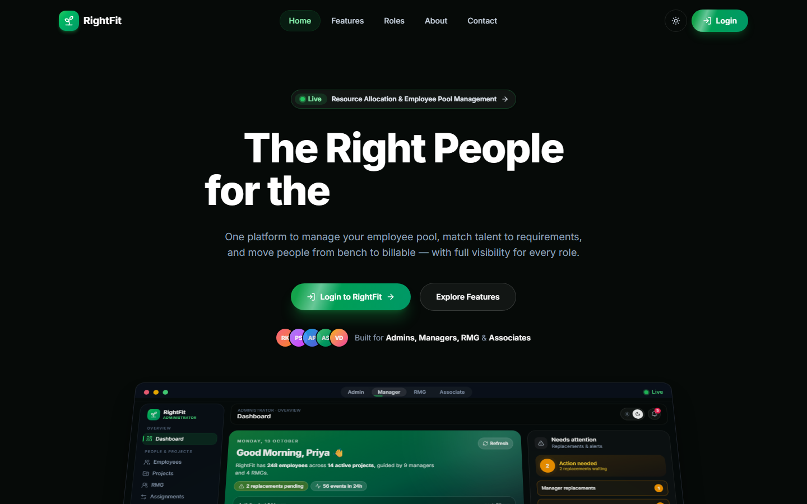
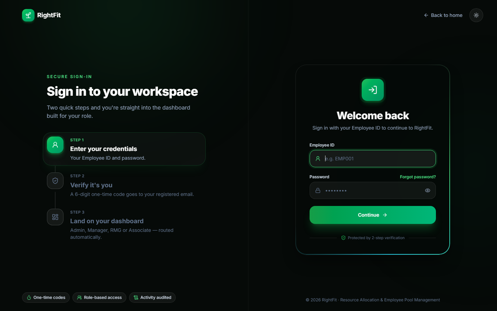
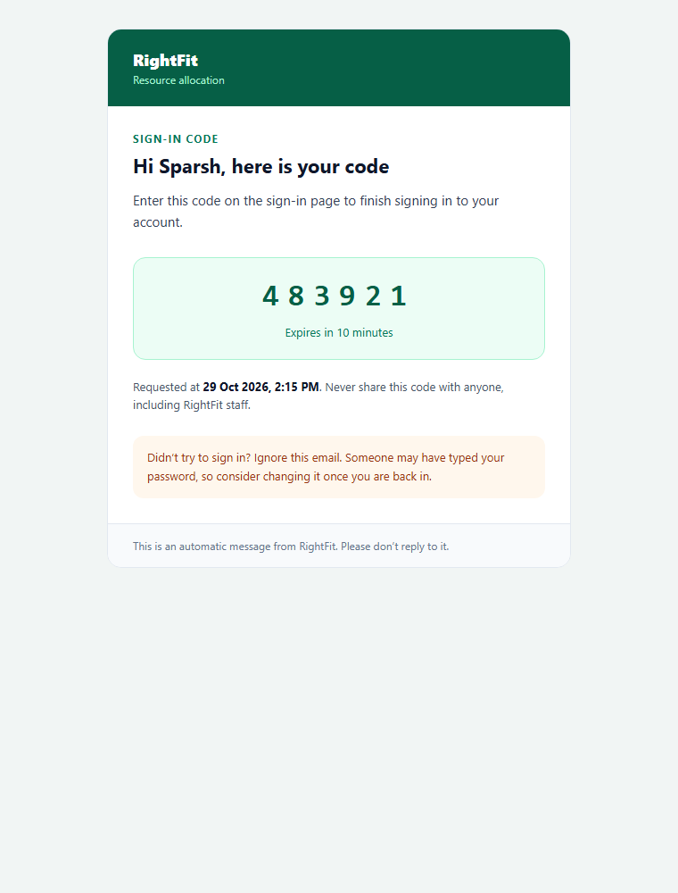
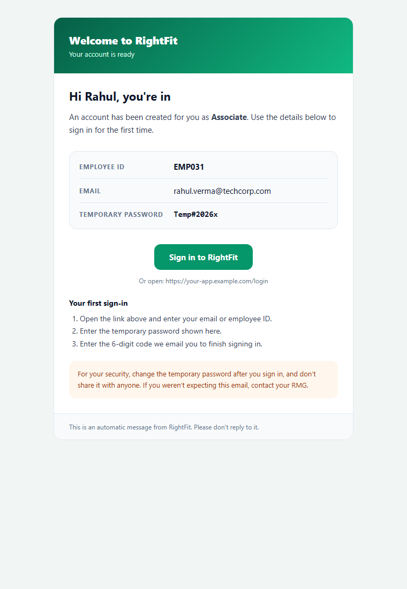
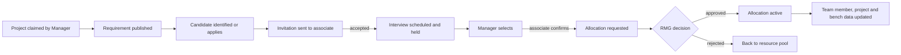
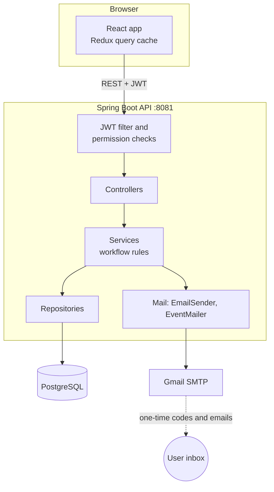

# RightFit

RightFit is a resource allocation and employee pool platform. It helps a company place its people on client projects: a project raises requirements, managers find and invite candidates, interviews and selections happen in the app, and the Resource Management Group (RMG) approves each allocation. Anyone who isn't on a project sits in the **resource pool** and is tracked on the **bench**, with training available while they wait.

- **Frontend:** `frontend/`, a React single-page app
- **Backend:** `backend/`, a Spring Boot REST API
- **Database:** PostgreSQL, with schema changes kept as Flyway migrations

| | Link |
|---|---|
| **App (frontend)** | https://rightfitapplication.vercel.app |
| **API (backend)** | https://rightfit-application.onrender.com |
| **Source code** | https://github.com/sparshchaturvedi78/RightFit |

---

## Contents

1. [Who uses it](#who-uses-it)
2. [Screenshots](#screenshots)
3. [How the application flows](#how-the-application-flows)
4. [Tech stack and what each part does](#tech-stack-and-what-each-part-does)
5. [Architecture](#architecture)
6. [Project structure](#project-structure)
7. [Getting started](#getting-started)
8. [Configuration](#configuration)
9. [Authentication and sign-in](#authentication-and-sign-in)
10. [Emails](#emails)
11. [Testing](#testing)
12. [Data and migrations](#data-and-migrations)
13. [Troubleshooting](#troubleshooting)

---

## Who uses it

| Role | What they do in RightFit |
|---|---|
| **Admin** | Manages employees, projects, users and sign-in access, the skills and certification catalogs, the bench policy, reports and the audit log. At least one active admin must remain. |
| **RMG** (Resource Management Group) | Runs the resource pool and bench, approves allocation requests, approves or declines training requests, manages training programs and assignments, and handles availability checks. |
| **Manager** | Claims projects assigned to them, raises requirements, sources and invites candidates, runs interviews, selects people, and requests allocations for their projects. |
| **Associate** | Keeps a profile (skills, certifications, availability), answers invitations and interviews, applies to open requirements, asks to join training, and sees their project and team. |

A person can hold more than one role. The Admin Users page shows each person under every role they hold.

---

## Screenshots

**Public pages**

| Home | Sign in |
|---|---|
|  |  |

**Emails sent by the platform**

| Sign-in code | Welcome with credentials |
|---|---|
|  |  |

**Role dashboards and pages**

These need a signed-in session, so they are not captured here yet. Add them under `docs/screenshots/` and link them below.

| Screen | Image |
|---|---|
| Admin: projects and project drawer | `docs/screenshots/03-admin-projects.png` (to add) |
| Admin: users by role | `docs/screenshots/04-admin-users.png` (to add) |
| Admin: reports, workforce | `docs/screenshots/05-admin-reports.png` (to add) |
| Admin: bench policy | `docs/screenshots/06-admin-bench-policy.png` (to add) |
| Associate: pool dashboard | `docs/screenshots/07-associate-dashboard.png` (to add) |
| RMG: training programs and interest requests | `docs/screenshots/08-rmg-training.png` (to add) |

---

## How the application flows

### Requirement to allocation



Each candidate moves through a pipeline: **identified → shortlisted → invitation sent → interview → manager review → selected → allocation requested → allocated**. A candidate can also be rejected, declined, or put on hold. A requirement can have one candidate at allocation stage, so when one is allocated the others are released.

### Resource pool and bench

- A new active employee who is available and unallocated enters the pool on day one (`MANUAL_ENTRY`).
- An allocation that ends returns the person to the pool (`ALLOCATION_END`).
- **Bench status** is derived from the days on the bench, against the active bench policy: for example green up to 30 days, amber up to 45, red from 46. Policies are versioned, so a change applies from a chosen date and earlier periods keep their rules.

### Training

1. An associate in the pool either waits to be assigned, or asks to join a course.
2. The RMG approves or declines the request. The RMG gives a reason when declining, which the associate sees with the decision (up to 1000 characters).
3. Approved and assigned training moves through `ASSIGNED → IN_PROGRESS → COMPLETED`. The RMG records the outcome, score and certificate.
4. A training program can have a seat limit. Approving a request is refused when all seats are taken.

### Project claim

A manager is assigned a project by an admin or RMG. The project shows as **unclaimed** until the manager claims it, and the claim is recorded with who did it and when.

### Sign-in

Employee ID plus password, then a 6-digit one-time code sent by email. The code expires after 10 minutes and works once. See [Authentication and sign-in](#authentication-and-sign-in).

---

## Tech stack and what each part does

### Frontend (`frontend/`)

| Technology | Used for |
|---|---|
| **React 19 + TypeScript** | Pages and components, typed against the API models |
| **Vite** | Dev server on port 5173 and production builds |
| **react-router** | Routes per role (`/admin/*`, `/manager/*`, `/rmg/*`, `/associate/*`) and sign-in redirect |
| **Redux Toolkit** | Shared app state, and the query cache (`store/queriesSlice.ts`, `store/queryRegistry.ts`). A list is fetched once per search or filter, then served from the store until it is invalidated. |
| **axios** (`services/httpClient.ts`) | HTTP calls to the backend, with the JWT attached |
| **Tailwind CSS v4** | Styling, with light and dark themes driven by design tokens |
| **motion** | Transitions and animated counters |
| **lucide-react** | Icons |

Frontend folders:
- `src/pages/` one folder per role, plus `HomePage` and `LoginPage`
- `src/services/` one file per API area, which calls the backend
- `src/components/` shared UI: `ui/` (Dropdown, Modal, form controls), `layout/` (sidebar, notifications), `dashboard/` (panels and tiles)
- `src/store/` Redux slices and the query registry
- `src/hooks/` `useQuery`, `useResource`, `useToast`

The API base URL comes from `VITE_API_BASE_URL` and defaults to the hosted API, `https://rightfit-application.onrender.com`. For local development, set `VITE_API_BASE_URL=http://localhost:8081` in `frontend/.env.local`.

### Backend (`backend/`)

| Technology | Used for |
|---|---|
| **Spring Boot 4.1** on **Java 17** | REST API, dependency injection, configuration |
| **Spring Web MVC** | 45 controllers, grouped by role (`Admin*`, `Manager*`, `Rmg*`, `Associate*`, plus `Auth`, `Notification`, `AllocationRequest`) |
| **Spring Security + JWT** | Stateless API auth, `@PreAuthorize` checks against permission codes |
| **Spring Data JPA / Hibernate** | Repositories and entities (about 43 entities) |
| **Flyway** | Versioned schema migrations, run at startup |
| **PostgreSQL driver** | Database access |
| **Spring Mail (JavaMail, Gmail SMTP)** | One-time codes, the welcome email and event emails |
| **Lombok** | Less boilerplate on entities and DTOs |
| **Spring `@Async` and transaction synchronization** | Event emails are sent after the database commit, in the background |
| **Spring `@Scheduled` and `@EnableCaching`** | Background jobs and caching for read-heavy lookups |
| **Apache POI** | Excel exports of reports |

Backend folders (under `backend/src/main/java/com/rightFit/`):
- `controller/` REST endpoints
- `service/` business rules: candidate workflow, allocations, training, reports, auth, mail
- `repository/` Spring Data repositories
- `entity/` JPA entities
- `dto/` request and response shapes
- `security/` JWT filter, authorization aspect
- `exception/` error mapping

### Database

| Technology | Used for |
|---|---|
| **PostgreSQL 16** | Application data. Local development uses Docker (`docker-compose.yml`). The hosted instance is on Neon. |
| **Flyway** (`backend/src/main/resources/db/migration/`) | Every schema change as a numbered `V<n>__name.sql`. Migrations are never edited after they run. |

### Email templates

Templates are plain HTML files with `{{placeholders}}`, in `backend/src/main/resources/mail/`:

| File | Used for |
|---|---|
| `login-otp.html` | Sign-in code |
| `security-otp.html` | Email verification, password reset and account recovery codes |
| `account-created.html` | Welcome with employee ID, temporary password and sign-in link |
| `event.html` | Shared layout for event emails: invitation, interview, selection, allocation, team, project claim, training, password changed, forgot-password code |

Values are HTML-escaped. Event emails pick their accent colour, heading, details and button in `EventMailer.java`.

### Developer tooling

- **Maven wrapper** (`./mvnw`) for the backend
- **npm** scripts for the frontend: `dev`, `build`, `lint`, `preview`
- **Docker Compose** for the local PostgreSQL container
- **Dockerfile** in `backend/` for a container build of the API

---

## Architecture



- **Controllers** check the request shape and call one service method.
- **Services** hold the rules: the candidate pipeline, allocation approval, seat limits, bench status and password history.
- **Repositories** are plain Spring Data interfaces.
- **Mail** runs after the transaction commits, so a slow or failed mail server never undoes or blocks an action.

---

## Project structure

```
RightFit/
├── README.md
├── docs/screenshots/            screenshots used in this README
├── backend/
│   ├── pom.xml
│   ├── mvnw / mvnw.cmd
│   ├── Dockerfile
│   ├── docker-compose.yml       PostgreSQL 16 for local development
│   ├── .env.example             copy to .env and fill in
│   └── src/
│       ├── main/java/com/rightFit/   controller, service, repository, entity, dto, security, exception
│       ├── main/resources/
│       │   ├── application.properties
│       │   ├── db/migration/          Flyway V0..V65
│       │   └── mail/                  HTML email templates
│       └── test/java/com/rightFit/    unit tests
└── frontend/
    ├── package.json
    ├── vite.config.ts
    └── src/
        ├── App.tsx                    routes per role
        ├── pages/                     admin, manager, rmg, associate, home, login
        ├── components/                ui, layout, dashboard, home
        ├── services/                  API clients
        ├── store/                     Redux store and query registry
        └── hooks/
```

---

## Getting started

### Prerequisites

- **Java 17** (the Maven wrapper is included, so Maven does not need installing)
- **Node.js 20+** and **npm**
- **Docker** (for the local PostgreSQL), or a PostgreSQL 16 database you can reach
- A **Gmail account with an App Password**, if you want real emails. Without it, codes print to the backend console.

### 1. Database

```bash
cd backend
docker compose up -d        # starts PostgreSQL 16 on port 5432
```

### 2. Backend configuration

```bash
cd backend
cp .env.example .env        # then fill in the values (see Configuration)
```

The backend reads these as environment variables. The project does not load `.env` itself, so export them in your shell or use your IDE's env-file setting (IntelliJ: EnvFile plugin).

### 3. Run the backend

```bash
cd backend
./mvnw spring-boot:run      # Windows: mvnw.cmd spring-boot:run
```

The API starts on **http://localhost:8081** (change with `PORT`). Flyway applies any pending migrations at startup. Look for `Started RightFit` in the log.

### 4. Run the frontend

```bash
cd frontend
npm install
npm run dev                 # http://localhost:5173
```

To point the frontend at a local API, set `VITE_API_BASE_URL=http://localhost:8081` in `frontend/.env.local` (the `npm run dev` setup above uses this).

### 5. Sign in

Development accounts are created by the seed data (not in the repository). Each uses the employee ID as the sign-in ID and the password `Admin@123`.

| Role | Example employee ID |
|---|---|
| Admin | EMP001 |
| RMG | EMP002, EMP003 |
| Manager | EMP004, EMP005, EMP006 |
| Associate | EMP007 to EMP024 |

> `Admin@123` is for local development only. Change it in any shared environment.

### Build for production

```bash
cd frontend && npm run build       # type-checks, then writes frontend/dist/
cd backend && ./mvnw -DskipTests package
```

---

## Deployment

| Part | Hosted on | Region | Notes |
|---|---|---|---|
| Frontend | Vercel (`rightfitapplication.vercel.app`) | global CDN | Built from `frontend/` with `npm run build` |
| Backend API | Render (`rightfit-application.onrender.com`) | Singapore | Web service built from `backend/` |
| Database | Neon Postgres | Singapore (`ap-southeast-1`) | Pooled connection used by the backend |

Keep the three in the same region where you can. Each hop between the backend and the database, or between a user and the API, adds latency to every request.

**Render environment variables** (set on the backend service):

| Variable | Value |
|---|---|
| `DB_URL` | `jdbc:postgresql://<pooled host>/neondb?sslmode=require` |
| `DB_USER`, `DB_PASSWORD` | from the Neon connection details. Never commit them. |
| `JWT_SECRET`, `TZ` | as in Configuration |
| `MAIL_USERNAME`, `MAIL_PASSWORD`, `MAIL_FROM` | Gmail account and App Password |
| `APP_MAIL_ENABLED` | `true` to send email |
| `APP_CORS_ALLOWED_ORIGINS` | optional. The Vercel app is allowed by default. |

**Vercel:** no variables are needed. The frontend calls the Render API by default. Set `VITE_API_BASE_URL` only to point it elsewhere.

## Configuration

### Backend environment variables

| Variable | Required | Purpose |
|---|---|---|
| `DB_URL` | yes | JDBC URL, for example `jdbc:postgresql://localhost:5432/rightfit` |
| `DB_USER`, `DB_PASSWORD` | yes | Database login |
| `POSTGRES_DB`, `POSTGRES_USER`, `POSTGRES_PASSWORD` | for Docker | Used by `docker-compose.yml` to create the database |
| `TZ` | yes | Time zone for timestamps, for example `Asia/Kolkata` |
| `JWT_SECRET` | yes | Signing key for access and refresh tokens. Use a long random value. |
| `MAIL_USERNAME` | for email | Gmail address that sends the mail |
| `MAIL_PASSWORD` | for email | Gmail **App Password** for that address (not the account password) |
| `MAIL_FROM` | for email | The From address, normally the same Gmail address |
| `APP_MAIL_ENABLED` | no | `true` sends real email. `false` (default) prints codes to the console. |
| `APP_LOGIN_URL` | no | Sign-in link in the welcome email. Default `https://rightfitapplication.vercel.app/login`. |
| `APP_FRONTEND_URL` | no | Frontend base URL used in event email links. Default `https://rightfitapplication.vercel.app`. |
| `APP_CORS_ALLOWED_ORIGINS` | for a deployed frontend | Comma-separated frontend origins allowed to call the API. Defaults to the Vercel app. Localhost is always allowed. |
| `PORT` | no | API port. Default `8081`. |

### Other settings (`application.properties`)

| Property | Default | Meaning |
|---|---|---|
| `app.otp.expiry-minutes` | `10` | How long a one-time code is valid |
| `app.otp.length` | `6` | Digits in a code |
| `app.frontend.url` | `https://rightfitapplication.vercel.app` | Base for links in event emails (set by `APP_FRONTEND_URL`) |
| `app.file.upload-dir` | `uploads` | Where certification documents are stored |

### Frontend

| Variable | Default | Meaning |
|---|---|---|
| `VITE_API_BASE_URL` | `https://rightfit-application.onrender.com` | Backend API base URL. Set `http://localhost:8081` for local development. |

---

## Authentication and sign-in

1. **Password check:** the user enters their employee ID and password. Passwords are stored as bcrypt hashes. The last few passwords are kept so a password cannot be reused right away.
2. **Code by email:** a 6-digit code is emailed. Codes expire after 10 minutes and can be used once.
3. **Session:** on success the API returns a short-lived **access token** and a **refresh token**. Refresh tokens can be revoked on sign-out.
4. **Lockout:** repeated failed sign-ins lock the account for a while. An admin can unlock it.
5. **Forgot password:** a code is emailed, then the new password is set. A confirmation email follows.
6. **Blocked accounts:** an admin can block a user from signing in, with a reason, and unblock them later.

Every sign-in and sensitive change is written to the audit log, which admins can search.

---

## Emails

| Event | Who gets it |
|---|---|
| Sign-in code | The user signing in |
| Forgot-password code | The user resetting their password |
| Password changed | The user, after a reset or a change |
| Welcome with credentials | A new employee, when an admin creates them |
| Interview invitation | The associate invited |
| Interview scheduled | The candidate |
| Selected / not selected | The candidate |
| Allocation requested | The RMG for the associate |
| Allocation approved | The associate, and the requesting manager |
| Allocation rejected | The requesting manager, with the reason |
| Team member added | The associate |
| Project claimed | The manager who claimed it |
| Training assigned | The associate |
| Training request decided | The associate, with the RMG's reason |

**To turn email on:** set `MAIL_USERNAME`, `MAIL_PASSWORD` (an App Password), `MAIL_FROM`, and `APP_MAIL_ENABLED=true`.

**To change the sign-in link** in the welcome email, set `APP_LOGIN_URL` to the deployed address. Event emails use `app.frontend.url`.

Codes are sent straight away, because the user is waiting for them. Event emails are sent in the background after the database change commits.

---

## Testing

```bash
cd backend && ./mvnw test           # unit tests, including mail template rendering
cd frontend && npm run lint         # ESLint
cd frontend && npx tsc -p tsconfig.app.json --noEmit   # type-check
```

Current automated coverage is limited. The backend has unit tests for the mail templates (placeholders, escaping, layout). The frontend is checked by type-checking and linting. Integration tests for the workflows are a good next step.

---

## Data and migrations

- Schema changes are **Flyway migrations** in `backend/src/main/resources/db/migration/`, named `V<number>__description.sql`. Add a new file for each change. Do not edit one that has already run.
- Reference data (roles, permissions, skills, departments, locations, rejection reasons, bench policy) is loaded by migrations.
- Application data (employees, projects, candidates, allocations and so on) comes from the seed used during development. It is not part of the migrations.

---

## Troubleshooting

| Symptom | Likely cause and fix |
|---|---|
| Code appears in the backend console and not in the inbox | `APP_MAIL_ENABLED` is `false`, or `MAIL_PASSWORD` is not an App Password. Check the console for `Authentication failed`. |
| `Failed to send OTP email` at sign-in | Gmail rejected the login. Create a new App Password and set `MAIL_PASSWORD`. |
| Backend cannot connect to the database | Check `DB_URL`, the Docker container status (`docker compose ps`), and port 5432. |
| Sign-in fails with "Invalid password" for seeded accounts | The seed hashes must match `Admin@123`. Re-run the password update for the development users. |
| Frontend shows network errors | Check that the backend is running on the port in `VITE_API_BASE_URL`. |
| Sign-in shows "Network Error" on the Vercel app, and the preflight returns 403 | The backend does not allow the frontend's origin. The default already includes `https://rightfitapplication.vercel.app`, so check `APP_CORS_ALLOWED_ORIGINS` on Render, and redeploy after code changes. |
| First request to the hosted API takes around 20 seconds | Render's free service sleeps when idle and wakes on the next request. |
| Sign-in code never arrives | Check that `APP_MAIL_ENABLED=true` and that `MAIL_PASSWORD` is a valid App Password. Use the sign-in email, not the forgot-password one. |
| A migration fails at startup | Read the Flyway error in the log. Do not edit an applied migration. Add a new one that fixes it. |
